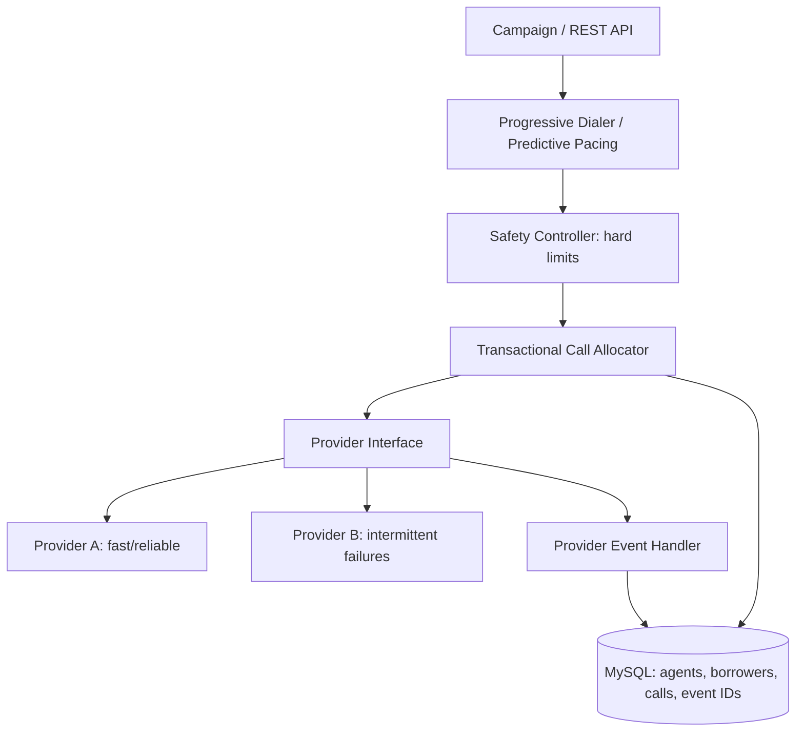

# SmartDialer architecture

The pacing engine only proposes a count. The Safety Controller independently applies hard capacity and provider-health checks. Allocation uses pessimistic row locks and entity versions; database state is the source of truth. Provider event IDs are persisted to make repeated deliveries idempotent. Production-grade delivery would additionally use a transactional outbox, provider reconciliation and lease-based worker recovery.
